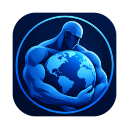
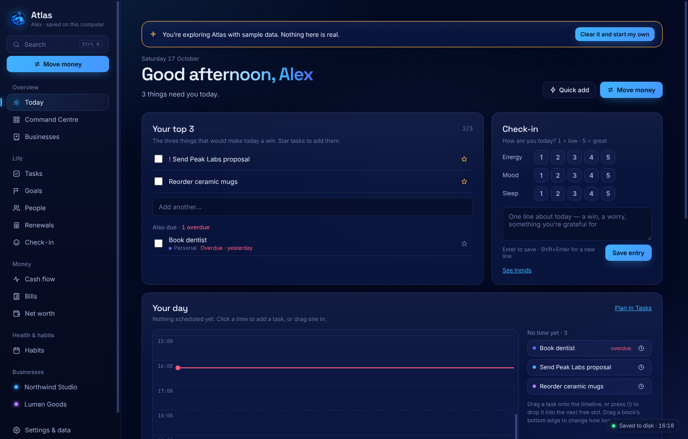
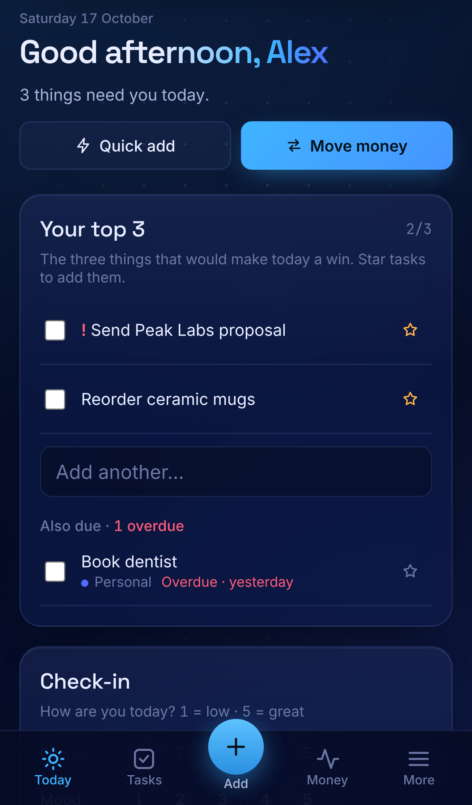
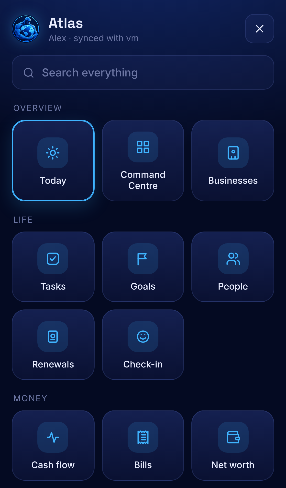
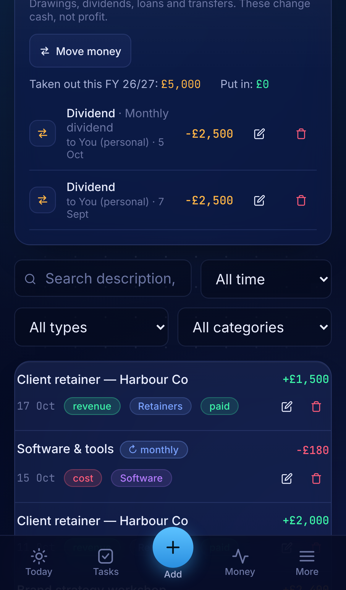

<h1 align="center">Atlas</h1>

<b>One private command centre for your businesses and your life.</b> 
Money, clients, tasks, habits, goals and health in one app that keeps everything on <i>your</i> computer.

<a href="../../releases/latest"><b>⬇ Download the latest version</b></a> ·
<a href="INSTALL-MAC.md">Mac setup</a> ·
<a href="INSTALL-WINDOWS.md">Windows setup</a> ·
<a href="PHONE.md">Phone setup</a>

## What it does

| | |
|---|---|
| **Today** | Your top 3, a timed day plan, what needs attention (overdue invoices, bills, renewals, birthdays), a daily check-in and habits. |
| **Businesses** | Each business gets a dashboard, ledger, balance sheet, contacts pipeline, stock and analytics tailored to its type (consulting, e-commerce, trading and more). |
| **Money** | Move money between your businesses and yourself (drawings, dividends, salary, loans), plus cash flow, bills, budgets, net worth and multi-currency support. |
| **Life** | Tasks with times, goals with milestones, people (birthdays, keeping in touch), renewals (passport, insurance), check-in and journal. |
| **Health** | Habits, gym log and running. |
| **Phone** | A phone version that works offline and syncs straight with your computer, encrypted, wherever you are. Install it from a link, with no app store and no certificate. |

## Private by design
- **No account and no cloud.** Your data is a single file on your computer: `Documents/Atlas/atlas-data.json`.
- Atlas saves within a second of every change and keeps a dated backup every day (the last 60 days).
- Phone sync goes directly between your phone and your computer, encrypted end to end. The internet is only used for the two devices to find each other. Your data isn't stored online anywhere.

## Get it
1. Open **[Releases](../../releases/latest)** and download the file for your computer:

   | Your computer | Download |
   |---|---|
   | Mac with Apple chip (M1, M2, M3, M4) | `Atlas-<version>-Mac-AppleSilicon.zip` |
   | Mac with Intel chip | `Atlas-<version>-Mac-Intel.zip` |
   | Windows 10 or 11 | `Atlas-Setup-<version>-Windows.exe` |

   Not sure which Mac you have? Click the Apple menu  → **About This Mac**. "Chip: Apple M…" means Apple chip. "Processor: Intel" means Intel.
2. Follow the short guide: **[Mac](INSTALL-MAC.md)** or **[Windows](INSTALL-WINDOWS.md)**.
3. Optional: put Atlas on your phone. On your computer go to **Settings → Atlas on your phone → Connect a phone** and scan the code. Full steps: **[Phone setup](PHONE.md)**.

When Atlas opens for the first time, a short setup asks your name and what you want to use. You can also explore with sample data first and clear it with one click.

## Phone

  

## Updating
Download the newest release and install it over the old one, the same way you installed it. Your data stays in `Documents/Atlas` and isn't touched.

## Questions
- **"Apple could not verify Atlas is free of malware" or "Windows protected your PC"**: Apple and Microsoft show this for every app that isn't registered with them through a paid developer programme. It doesn't mean anything was found. The **[Mac](INSTALL-MAC.md)** and **[Windows](INSTALL-WINDOWS.md)** guides show exactly what to click, once.
- **Where's my data?** In Atlas go to **Settings & data → Open data folder**. To move it into iCloud Drive or OneDrive for an off-computer copy, use **Move data folder…**.
- **Moving to a new computer:** copy the `Documents/Atlas` folder across, or use **Settings & data → Export** and **Import** in the new install.

---
© Atlas. All rights reserved.
